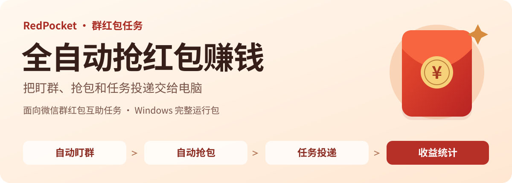
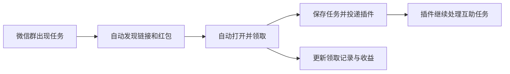
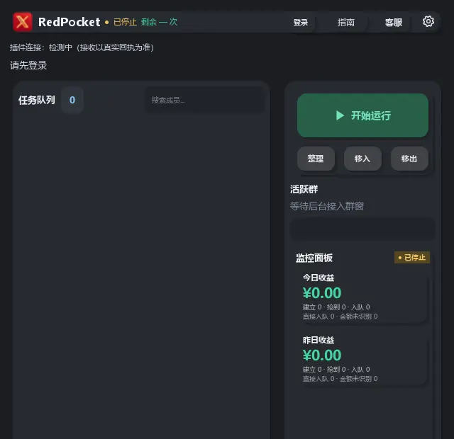
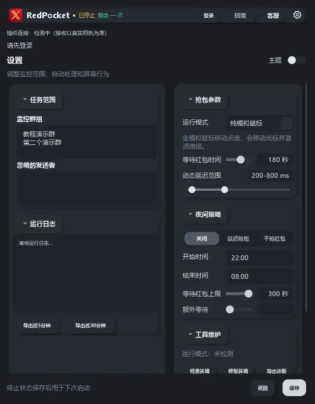

<!-- 下载页文档 v0.0.1 | 客户端 v1.23.2a | 2026-11-18 -->

[](https://github.com/wearescientist/redpocket-downloads/releases/download/v1.23.2a/RedPocket-v1.23.2a-Windows-x64.zip)

<div align="center">

### [⬇ 立即下载 Windows 完整运行包](https://github.com/wearescientist/redpocket-downloads/releases/download/v1.23.2a/RedPocket-v1.23.2a-Windows-x64.zip)

**v1.23.2a 公测版 · Windows 64 位 · 约 124 MB · 解压即可启动**

[查看发布版本](https://github.com/wearescientist/redpocket-downloads/releases/tag/v1.23.2a) · [安装任务接收插件](https://chromewebstore.google.com/detail/x-super-assistant/gkfdiajookipedoolgfhmdpglcgcdiea?hl=zh-CN) · [快速上手](#几步开始自动抢包)

</div>

## 让电脑盯群，你来看收益

如果你平时在微信群里接红包互助任务，盯消息、点红包、复制链接、交给插件，每天都要重复很多遍。

**群红包任务 RedPocket 可以帮你全自动抢红包赚钱。** 配置好监控群和任务接收插件后，电脑会持续发现符合规则的任务、打开并领取红包，再把任务链接交给 X Super Assistant 继续处理。你可以直接在界面里查看任务进度和领取收益。



## 哪些事可以交给它

| 你关心的事 | 工具怎么做 |
| --- | --- |
| **自动盯群** | 持续监控你设置的群聊，发现符合规则的红包任务，支持多个群窗口。 |
| **自动抢红包** | 通过模拟鼠标打开、领取红包并读取结果，减少反复盯屏和手动点击。 |
| **自动接续任务** | 识别并保存任务链接，投递给已连接的 X Super Assistant，衔接后续互助流程。 |
| **收益随时可看** | 首页集中显示今日、昨日收益，以及任务建立、抢到和入队数量。 |
| **按自己的习惯运行** | 可以配置监控群、忽略的发送者、等待时间和夜间策略，也支持手抢辅助入队。 |
| **连接恢复后继续** | 插件断开时等待，同一接收目标恢复连接后自动继续。 |

## 打开软件，就能看到任务和收益

左侧看任务，右侧看活跃群、今日和昨日收益。开始、停止、群窗整理等常用操作都集中在首页。

<p align="center">
  
</p>

设置页可以统一配置监控群、运行模式和夜间策略。

<p align="center">
  
</p>

*以上为客户端界面预览，使用演示配置。*

## 几步开始自动抢包

1. **下载并完整解压。** 点击上方下载按钮，把 ZIP 解压到有写入权限的文件夹，运行根目录的 `群红包任务.exe`。包内已包含运行组件，保留完整目录即可。
2. **准备微信和插件。** 登录电脑微信，把需要监控的群聊弹出为独立窗口，并保持消息正常显示。安装 X Super Assistant，打开插件的任务接收功能。
3. **登录工具。** 按软件“指南”完成账户登录，确认账户有可用次数。需要购买时，可以从工具进入账户页查看。
4. **设置监控范围。** 在设置中填写群名，每行一个，按需要调整忽略名单和夜间策略。自动抢包选择“纯模拟鼠标”。
5. **检测后开始。** 按指南检测群窗，确认插件已连接，完成首次设置，然后点击“开始运行”。首次出现任务时，核对红包领取和插件接收是否正常。

自动模式会移动鼠标并操作微信。运行时保持群窗口正常显示，也可以按指南使用可选虚拟屏集中摆放群窗。

## 下载前，几个常见问题

**钱从哪里来？**

收入来自你参与的微信群红包任务。工具负责自动监控、领取和衔接任务，实际收入与群内任务数量、红包金额和领取成功情况有关，以实际领取记录为准。

**一定要用 X Super Assistant 吗？**

完整任务流程需要配合适配插件。安装后还要打开任务接收功能，并确认工具显示已连接。

**可以自己抢，让工具帮忙整理任务吗？**

可以。选择“手抢辅助入队”后，你手动抢红包，工具负责识别任务并入队。切换模式前先停止运行。

**ZIP 在哪里？为什么首页文件列表里只有 README？**

Windows 完整运行包保存在 [Releases 的 Assets](https://github.com/wearescientist/redpocket-downloads/releases/tag/v1.23.2a) 中。点击本页下载按钮，或在 Assets 中选择 **`RedPocket-v1.23.2a-Windows-x64.zip`**。

**更新时怎么保留设置？**

先停止并退出旧工具，再将新包完整解压到原程序目录。保留原来的 `config.yaml` 和 `output`，继续使用已有设置和任务记录。

<details>
<summary>查看下载文件的 SHA-256 校验值</summary>

文件大小为 **129,789,245 字节**。下载后可以在 PowerShell 中核对。

```powershell
Get-FileHash -Algorithm SHA256 .\RedPocket-v1.23.2a-Windows-x64.zip
```

```text
654d296dafb11d3b9c1a6fe7db30c974ae0f54ffbccddf9cc59e3d40b4cc90af
```

</details>

---

### [⬇ 下载群红包任务，开始自动抢包](https://github.com/wearescientist/redpocket-downloads/releases/download/v1.23.2a/RedPocket-v1.23.2a-Windows-x64.zip)

安装、账户和异常排查也可以在软件内点击“指南”或“客服”查看。
